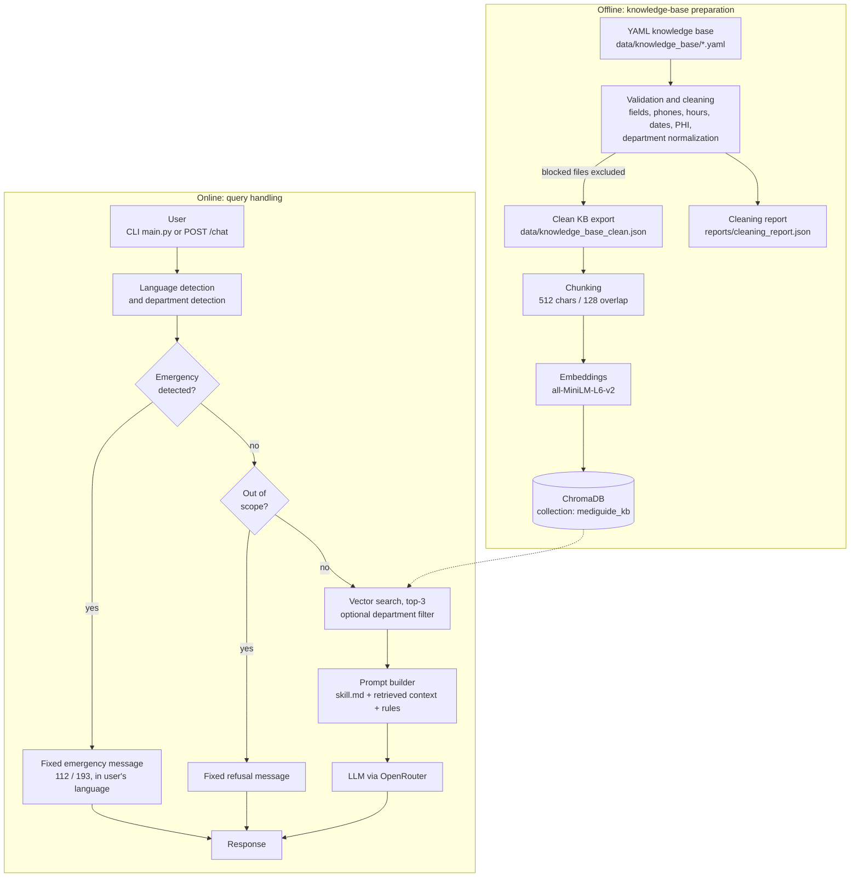

# MediGuide AI — RAG-Powered Hospital Inquiry Assistant

MediGuide AI is a retrieval-augmented generation (RAG) chatbot that answers patient questions about hospital departments, opening hours, locations, services, and NHIS (National Health Insurance Scheme) coverage. It was built for hospitals in Ghana and gives answers based on a curated, validated knowledge base. Messages describing emergencies or off-topic requests are caught by deterministic safety checks before they reach the language model.

The project includes a **command-line chat client** and a **Flask REST API** that a separate web frontend can call.

> **Note:** MediGuide AI is an informational assistant. It does not diagnose, prescribe, or replace medical professionals.

---

## Table of Contents

1. [Project Overview](#project-overview)
2. [Key Features](#key-features)
3. [Technology Stack](#technology-stack)
4. [System Architecture](#system-architecture)
5. [Project Structure](#project-structure)
6. [Installation](#installation)
7. [Environment Configuration](#environment-configuration)
8. [How the RAG Pipeline Works](#how-the-rag-pipeline-works)
9. [Example Usage](#example-usage)
10. [Screenshots and Demonstration](#screenshots-and-demonstration)
11. [Testing and Evaluation](#testing-and-evaluation)
12. [Limitations](#limitations)
13. [Future Improvements](#future-improvements)
14. [Author](#author)

---

## Project Overview

### The problem

In many hospitals, patients spend a lot of time just finding out where to go: which department handles their need, when it opens, whether NHIS is accepted, and what to bring. Inquiry desks get overloaded with the same questions. A general-purpose chatbot isn't safe here, because it can make up phone numbers, opening hours, or medical advice.

### The approach

MediGuide AI limits the language model to **verified hospital information**:

1. Hospital data is written as structured YAML files, one per department plus an FAQ file.
2. A validation pipeline checks each file for missing fields, malformed phone numbers and opening hours, stale or expired data, and protected health information (PHI) before export.
3. The cleaned data is split into chunks, embedded locally, and stored in a persistent ChromaDB vector store.
4. For each question, the system first runs safety checks for emergencies and off-topic requests. It then retrieves the most relevant chunks and tells the LLM to answer **only** from them.

### Practical applications

- Self-service patient inquiry kiosks or web chat widgets
- Reducing repetitive questions at the front desk
- Guiding patients to the right department (OPD, Laboratory, Pharmacy, Maternity, NHIS, Emergency)
- A reference implementation for domain-restricted RAG assistants in regulated settings

---

## Key Features

All of the features below are implemented in the current codebase.

| Feature | Description | Implementation |
|---|---|---|
| **Structured knowledge base** | Department profiles (location, hours, contacts, services, NHIS notes) and FAQs stored as YAML | `data/knowledge_base/` |
| **Knowledge-base validation** | Checks required fields, Ghana phone number formats, parseable opening hours, `last_verified` staleness (older than 30 days), and expired `valid_until` dates | `cleaning/yaml_cleaner.py`, `phone_validator.py`, `hours_validator.py` |
| **PHI detection and blocking** | Regex detection of Ghana Card numbers, NHIS card numbers, medical record numbers, dates of birth, and diagnosis or prescription patterns. Files with high-severity matches are blocked from export | `cleaning/phi_detector.py` |
| **Department normalization** | Maps aliases such as "A&E", "casualty", or "dispensary" to canonical department names | `cleaning/dept_normalizer.py` |
| **Cleaning report** | Writes a JSON report of valid, blocked, PHI-flagged, and stale files | `cleaning/report.py` → `reports/cleaning_report.json` |
| **Chunking** | Recursive character splitting (512 characters, 128 overlap), with chunks built separately for department summaries, descriptions, NHIS notes, and FAQs | `ingestion/loaders.py` |
| **Local embeddings** | Sentence-Transformers `all-MiniLM-L6-v2`. No embedding API is needed | `ingestion/embedder.py` |
| **Persistent vector search** | ChromaDB `PersistentClient` with cosine similarity (HNSW), top-3 retrieval | `ingestion/embedder.py`, `retrieval/search.py` |
| **Department-aware filtering** | If a query mentions a department, retrieval is limited to that department's chunks through a metadata filter | `retrieval/detector.py`, `retrieval/search.py` |
| **Emergency bypass** | Regex patterns for chest pain, breathing difficulty, severe bleeding, stroke, seizures, overdose, suicidal intent, and similar cases. These return a fixed message pointing to the Emergency Unit and 112 / 193 **without calling the LLM** | `retrieval/emergency.py` |
| **Out-of-scope refusal** | Keyword and pattern filters for politics, sports, crypto, hacking, gambling, legal or financial advice, and similar topics. These return a polite fixed refusal without calling the LLM | `retrieval/out_of_scope.py` |
| **Multilingual support** | Heuristic language detection for Twi, Ga, Ewe, Hausa, and Dagbani. Emergency and refusal messages are pre-written in each language, and the LLM is told to reply in the user's language | `retrieval/detector.py`, `generation/prompt.py` |
| **Grounded prompting** | The system prompt combines a behavioral policy (`skill.md`), the retrieved context, and strict instructions not to invent contacts, hours, or locations | `generation/prompt.py` |
| **Conversation memory** | The last 6 messages are sent with each LLM request | `generation/generate.py` |
| **REST API** | Flask app with `GET /health` and `POST /chat`, CORS configurable | `server.py` |
| **CLI client** | Interactive terminal chat with a `status` command | `main.py` |
| **Graceful degradation** | If the vector store is empty or unavailable, the app runs in prompt-only mode instead of crashing. Rate-limit errors return a friendly message | `main.py`, `server.py`, `generation/generate.py` |
| **Deployment config** | `Procfile` for Gunicorn on Heroku-style platforms | `Procfile` |

---

## Technology Stack

| Technology | Purpose |
|---|---|
| **Python 3.12+** | Core language (`.python-version` pins 3.14 for `uv`) |
| **ChromaDB** | Persistent local vector database (cosine / HNSW) |
| **Sentence-Transformers** (`all-MiniLM-L6-v2`) | Local text embeddings, used through ChromaDB's embedding function |
| **LangChain Text Splitters** | `RecursiveCharacterTextSplitter` for chunking |
| **OpenAI Python SDK** | Client for the OpenAI-compatible **OpenRouter** API |
| **OpenRouter** | LLM gateway. The model is set with `OPENROUTER_MODEL` (default: `nvidia/nemotron-3.5-lightning:free`) |
| **Flask** + **Flask-CORS** | REST API backend |
| **Gunicorn** | Production WSGI server (Linux/macOS) |
| **PyYAML** | Knowledge-base parsing |
| **python-dotenv** | Loading environment variables from `.env` |
| **uv** | Dependency management (`pyproject.toml` + `uv.lock`) |

---

## System Architecture



---

## Project Structure

```text
Chatbott/
├── main.py                     # CLI chat client (entry point)
├── server.py                   # Flask REST API: /health, /chat (entry point)
├── skill.md                    # Assistant policy: scope, safety, tone, language rules (loaded into the system prompt)
├── pyproject.toml              # Project metadata and dependencies
├── uv.lock                     # Locked dependency versions for uv
├── .python-version             # Python version pin for uv
├── .env.example                # Template for required environment variables
├── Procfile                    # Gunicorn start command for PaaS deployment
│
├── cleaning/                   # Knowledge-base validation and text-cleaning utilities
│   ├── yaml_cleaner.py         # YAML structure, date, phone, hours, and PHI validation; load + normalize
│   ├── phi_detector.py         # Regex-based protected health information detection
│   ├── phone_validator.py      # Ghana phone number parsing and validation
│   ├── hours_validator.py      # Opening-hours parsing and sanity checks
│   ├── dept_normalizer.py      # Department alias → canonical name mapping
│   ├── report.py               # Cleaning report generation and console summary
│   ├── text_cleaner.py         # Raw-text cleaning helpers (encoding, page artifacts, whitespace)
│   ├── ocr_cleaner.py          # OCR error-correction helpers
│   └── pipeline.py             # Composite cleaning functions
│
├── scripts/
│   └── export_clean_kb.py      # Validates YAML files → writes clean JSON KB + cleaning report
│
├── ingestion/
│   ├── config.py               # Paths, collection name, chunk size/overlap, top-k, embedding model
│   ├── loaders.py              # Builds text chunks + metadata from the clean JSON KB
│   ├── embedder.py             # ChromaDB client, collection, embedding function, ingestion
│   └── ingest.py               # Ingestion entry point (python -m ingestion.ingest)
│
├── retrieval/
│   ├── router.py               # Query pipeline: detect → emergency → scope → search
│   ├── detector.py             # Language, intent, and department detection
│   ├── emergency.py            # Emergency patterns and multilingual emergency responses
│   ├── out_of_scope.py         # Off-topic filters and multilingual refusals
│   └── search.py               # Vector search and context formatting
│
├── generation/
│   ├── prompt.py               # System-prompt construction
│   └── generate.py             # OpenRouter chat-completion call
│
├── data/
│   ├── knowledge_base/         # Source YAML: emergency, laboratory, maternity, nhis, opd, pharmacy, faqs
│   └── knowledge_base_clean.json  # Validated export used for ingestion
│
├── chroma_db/                  # Persisted ChromaDB vector store
└── reports/
    └── cleaning_report.json    # Latest validation report
```

**Current knowledge base:** 6 department files and 1 FAQ file (20 FAQs), which produce **40 chunks** in the vector store. The included data is sample hospital content for demonstration.

---

## Installation

### Prerequisites

- Python 3.12 or newer
- An [OpenRouter](https://openrouter.ai/) API key
- Internet access on first run, to download the `all-MiniLM-L6-v2` embedding model from Hugging Face

### 1. Clone the repository

```bash
git clone <your-repository-url>
cd Chatbott
```

### 2. Create a virtual environment and install dependencies

**Option A: uv (recommended, uses `uv.lock`)**

```bash
uv sync
```

Then activate the environment (`source .venv/bin/activate` on macOS/Linux, `.venv\Scripts\activate` on Windows), or prefix the commands below with `uv run`.

**Option B: pip**

```bash
python -m venv .venv
# macOS/Linux
source .venv/bin/activate
# Windows
.venv\Scripts\activate

pip install "openai>=1.0.0" "python-dotenv>=1.0.0" "pyyaml>=6.0" "chromadb>=1.0.0" \
            "sentence-transformers>=3.0.0" "langchain-text-splitters>=0.3.0" \
            "flask>=3.0.0" "flask-cors>=4.0.0" "gunicorn>=23.0.0"
```

### 3. Configure environment variables

```bash
cp .env.example .env
```

Edit `.env` and set your OpenRouter API key. See [Environment Configuration](#environment-configuration).

### 4. Prepare the knowledge base (optional if you haven't edited the YAML files)

The repository already includes `data/knowledge_base_clean.json` and a populated `chroma_db/`. Re-run these steps after you change any YAML file.

```bash
# Validate the YAML files and export the clean knowledge base
# → writes data/knowledge_base_clean.json and reports/cleaning_report.json
python scripts/export_clean_kb.py

# Chunk, embed, and load into ChromaDB
# (clears the existing collection before re-ingesting)
python -m ingestion.ingest
```

### 5. Run the application

**Interactive CLI:**

```bash
python main.py
```

Type a question. Type `status` to see the document count and model, or `exit` to quit.

**REST API (development server):**

```bash
python server.py
# Starting MediGuide AI server on http://localhost:5000
```

**REST API (production, Linux/macOS):**

```bash
gunicorn server:app --bind 0.0.0.0:$PORT --timeout 120
```

---

## Environment Configuration

Variables are loaded from `.env` with `python-dotenv`. Never commit `.env`. It is already listed in `.gitignore`.

| Variable | Required | Default | Used in | Description |
|---|---|---|---|---|
| `OPENROUTER_API_KEY` | **Yes** | — | `generation/generate.py`, `main.py` | API key for OpenRouter. The CLI exits if it isn't set |
| `OPENROUTER_MODEL` | No | `nvidia/nemotron-3.5-lightning:free` | `generation/generate.py` | Any chat model ID available on OpenRouter |
| `FRONTEND_URL` | No | `*` (all origins) | `server.py` | Allowed CORS origin for the web frontend |
| `PORT` | No | `5000` | `server.py`, `Procfile` | HTTP port for the API server |

Tunable retrieval settings (chunk size, overlap, top-k, embedding model, collection name) are in [`ingestion/config.py`](ingestion/config.py).

---

## How the RAG Pipeline Works

### 1. Document loading
Hospital information is stored as YAML. Each department file contains `department`, `full_name`, `description`, `location`, `hours` (per day), `services`, `contact`, `nhis_accepted`, `nhis_notes`, and `last_verified`. `faqs.yaml` holds question/answer pairs tagged with `department` and `topic`.

### 2. Data cleaning and validation
`scripts/export_clean_kb.py` runs every YAML file through `cleaning/yaml_cleaner.py`:

- **Required-field checks.** A missing field is an error, and the file is blocked.
- **Phone validation** against Ghana mobile and landline prefixes and emergency short codes (warning).
- **Opening-hours parsing**, which flags unparseable strings, close-before-open times, and openings before 4 AM (warning).
- **Freshness checks.** `last_verified` older than 30 days gives a warning. A `valid_until` date in the past is an error, and the file is blocked.
- **PHI scanning.** High-severity identifiers (Ghana Card, NHIS card, MRN, date of birth) block the file.
- **Normalization.** Strings are trimmed and department aliases are mapped to canonical names.

Valid files are merged into `data/knowledge_base_clean.json`, and a full report is written to `reports/cleaning_report.json`.

### 3. Chunking
`ingestion/loaders.py` creates separate, typed chunks for each department:
- `department`: name, location, formatted hours, contact, NHIS acceptance, services
- `department_description`
- `nhis_info`

It also creates one `faq` chunk per Q&A pair. Text is split with `RecursiveCharacterTextSplitter` (512 characters, 128 overlap). Each chunk carries metadata (`type`, `department`, and `topic`/`faq_id` for FAQs).

### 4. Embedding generation
ChromaDB's `SentenceTransformerEmbeddingFunction` embeds the chunks locally with `all-MiniLM-L6-v2`. The same function embeds queries at search time.

### 5. Vector storage
Chunks are stored in a persistent ChromaDB collection (`mediguide_kb`) under `chroma_db/`, using cosine distance. Re-ingestion clears the collection first, so it never contains duplicate chunks.

### 6. Query processing
`retrieval/router.py` processes each message in this order:
1. **Detect language** by keyword overlap for Twi, Ga, Ewe, Hausa, and Dagbani. English is the default.
2. **Detect department** from keywords (e.g. "lab", "antenatal", "insurance").
3. **Emergency check.** On a match, return the fixed emergency message in the detected language. The LLM is not called.
4. **Scope check.** On a match, return the fixed refusal. The LLM is not called.

### 7. Retrieval
The top 3 chunks are retrieved by cosine similarity. If a department was detected, they're filtered to that department through `where={"department": ...}`. Chunks are formatted as numbered context blocks labeled with department and chunk type, for example `[1] (Laboratory - department): ...`.

### 8. Response generation
`generation/prompt.py` builds the system prompt from:
- the full behavioral policy in `skill.md` (scope, refusal, hallucination prevention, medical safety, tone, language rules)
- the retrieved context, introduced with *"ONLY use this information. Do NOT invent phone numbers, hours, or locations."*
- final rules, including a fixed fallback: *"I do not have that information. Please contact the hospital directly."*

The prompt, up to the last 6 conversation messages, and the user's question are sent to the configured OpenRouter model.

### Accuracy safeguards
- **Deterministic pre-LLM routing** for emergencies and off-topic requests, so these messages never depend on model behavior.
- **Grounding instructions** tell the model to answer only from retrieved context, with an explicit fallback message.
- **Data checks before ingestion**: PHI blocking, expiry and staleness checks, and format validation.
- **Department metadata filtering** to reduce irrelevant context.

---

## Example Usage

### REST API

**Health check:**

```bash
curl http://localhost:5000/health
```

Response shape (from `server.py`):

```json
{ "status": "ok", "rag": true, "documents": 40 }
```

**Chat request:** the client sends the full conversation history, and the last message must come from the user.

```bash
curl -X POST http://localhost:5000/chat \
  -H "Content-Type: application/json" \
  -d '{"history": [{"role": "user", "content": "What time does the laboratory open?"}]}'
```

Response shape:

```json
{ "reply": "<model-generated answer grounded in the Laboratory department chunks>" }
```

If `history` is missing or doesn't end with a user message, the API returns `400` with `{"error": "history must end with a user message"}`.

### Deterministic responses (no LLM call)

These replies are hard-coded in the source, so they're exact.

**Emergency:** a message such as *"I have chest pain"* matches an emergency pattern and returns:

> Your symptoms may require urgent medical attention. Please visit the nearest Emergency Unit immediately or call 112 (National Emergency) or 193 (Ambulance).

**Out of scope:** a message such as *"Who will win the football match?"* returns:

> I'm sorry, but I can only assist with healthcare and hospital-related questions.

### CLI session

```text
$ python main.py
Vector store ready: 40 documents loaded
MediGuide AI - Hospital Inquiry Assistant (RAG)
Type 'exit' to quit | 'status' to check system

You: Where is the OPD and what are its hours?
MediGuide: <model-generated answer>
```

Model-generated answers vary by model and aren't reproduced here.

---

## Screenshots and Demonstration

There are no screenshots or demo recordings in the repository yet. Planned captures (suggested location: `docs/screenshots/`):

| # | Screenshot | What it should show |
|---|---|---|
| 1 | **CLI: grounded answer** | `python main.py` startup ("Vector store ready: 40 documents loaded") and a correct answer about department hours or location |
| 2 | **CLI: emergency bypass** | An emergency message returning the fixed 112 / 193 response |
| 3 | **CLI: out-of-scope refusal** | An off-topic question being politely refused |
| 4 | **Multilingual reply** | A question in Twi (or another supported language) answered in the same language |
| 5 | **API: `/chat` request** | A Postman, Insomnia, or curl call to `POST /chat` with the JSON response |
| 6 | **Cleaning report** | Console output of `python scripts/export_clean_kb.py` showing the validation summary |
| 7 | **Frontend** (if used) | The web chat widget connected through `FRONTEND_URL` |

---

## Testing and Evaluation

**There is currently no automated test suite and no RAG evaluation harness.**

Quality controls that exist today:
- **Data-quality validation.** `scripts/export_clean_kb.py` produces `reports/cleaning_report.json`. The committed report shows all 7 knowledge-base files valid, with no PHI findings and no stale files at generation time.
- **Health endpoint.** `GET /health` reports whether RAG is active and how many documents are loaded.
- **CLI `status` command.** Shows the vector-store document count and the active model.

Not yet implemented, and listed under [Future Improvements](#future-improvements): unit tests, retrieval metrics (hit rate, MRR), answer faithfulness or groundedness scoring, and regression tests for the emergency and scope filters.

---

## Limitations

- **YAML-only ingestion.** There is no PDF, DOCX, or web-page loader. `cleaning/text_cleaner.py` and `cleaning/ocr_cleaner.py` contain raw-text and OCR cleanup helpers, but no ingestion path uses them yet.
- **No source citations in responses.** Retrieved chunks are labeled inside the prompt, but the API and CLI return only the answer text. No document names, page numbers, or chunk references are returned.
- **No relevance threshold.** Similarity scores are computed but not used to filter weak matches. The top 3 chunks are always passed to the model, and the "no information" fallback depends on the model following its instructions.
- **Keyword-based filters can give false positives.** Scope and department detection use substring matching. For example, "diabetes" contains "bet" and "drug" is on the off-topic list, so some legitimate pharmacy questions are refused. "lab" also matches inside words like "available".
- **Heuristic language detection.** Detection relies on short keyword lists that overlap with common English words. Some English sentences can be classified as a local language, which affects the language of the fixed emergency and refusal messages.
- **Strict department filter.** When a department is detected, retrieval is limited to that department, which can miss relevant context for questions that span departments.
- **Error handling in the API.** LLM errors are returned as reply text with HTTP 200 instead of an error status code.
- **No authentication or rate limiting** on the API. CORS defaults to all origins unless `FRONTEND_URL` is set.
- **External dependency.** Generation requires OpenRouter access. Free-tier models may be rate-limited or change over time.
- **No frontend, Docker image, or CI** in this repository.
- **Minor inconsistencies.** `main.py` tells users to run `scripts/ingest_kb.py`, which doesn't exist; use `python -m ingestion.ingest`. The `status` command shows a different fallback model name than the one `generation/generate.py` actually uses.

---

## Future Improvements

- **PDF ingestion with page-level metadata** (document name, page number), using the existing text and OCR cleaning helpers
- **Source citations** returned alongside each answer, plus citation verification against the retrieved chunks
- **Relevance thresholding**, so the system answers "I don't have that information" without calling the LLM when nothing relevant is retrieved
- **Hybrid retrieval** (BM25 + vectors) and **cross-encoder reranking**
- **Context-aware classifiers** (embedding or LLM based) to replace substring keyword matching for scope and department detection
- **Automated tests** (pytest) for the cleaning, routing, and API layers
- **RAG evaluation** with a labeled question set, measuring retrieval hit rate and answer faithfulness (e.g. with RAGAS)
- **FastAPI migration** with typed request/response schemas and OpenAPI docs
- **Docker** and CI/CD pipelines
- **API authentication, rate limiting**, and structured logging
- **Streaming responses** for a better chat experience
- **Web frontend** and integrations (e.g. WhatsApp), as outlined in `skill.md`

---

## Author

**Collins Amoah**

Software Developer | AI Integration | Full-Stack Development
